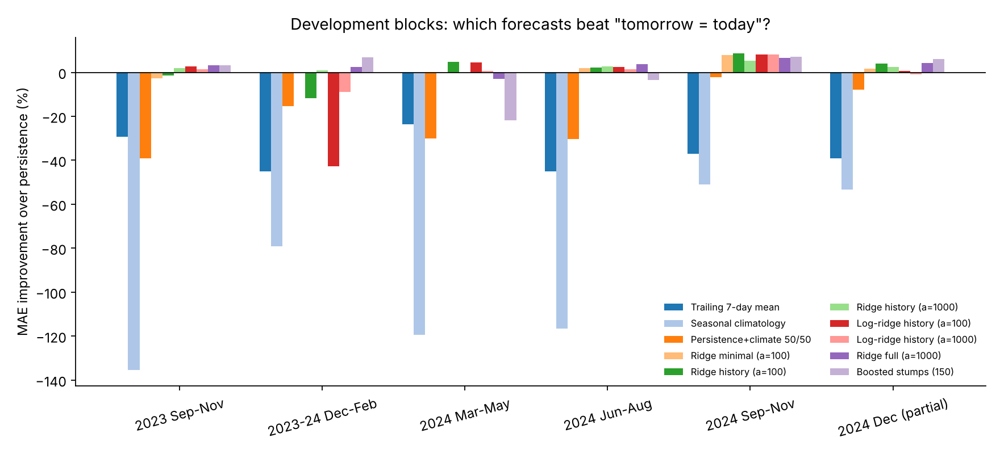
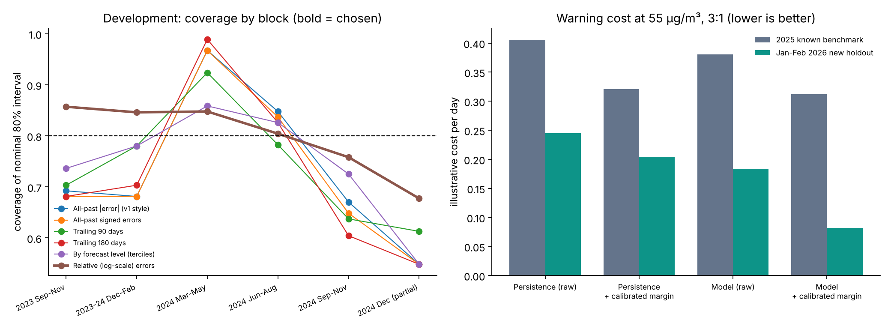
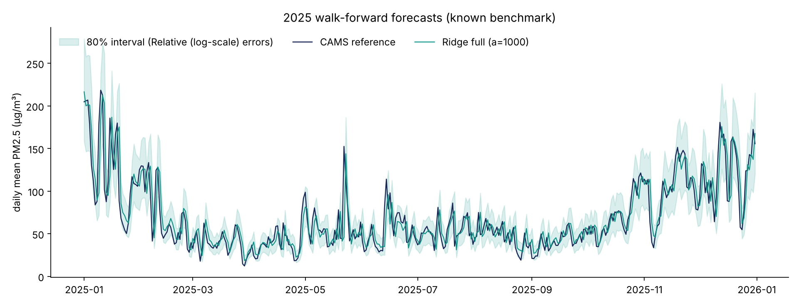

# SmogWindow
### Better forecasts do not automatically make better warnings.

**Veritas AI Hackathon 2026 · AI + Climate · Solo entry · version 2**

SmogWindow tests whether a machine-learning forecast of Lahore's next-day PM2.5 improves a school's outdoor-activity planning compared with simple baselines, and ships an offline decision dashboard that shows the forecast, its uncertainty, baseline comparisons, data-quality warnings and an exportable planning summary.

**This is a historical research prototype on modeled (CAMS) data. It is not live monitoring, medical advice, a safety clearance, or validated against real monitors or by any school.**

## Start here
- **Dashboard (no install):** open `SmogWindow_dashboard.html` in any browser, or run `python demo.py` / double-click `START_DEMO.bat`.
- **Colab:** upload `SmogWindow.ipynb` and Run all. The notebook embeds the data and every script; no API key or download.
- **Reproduce:** `python run_all.py` → `python build_dashboard.py` → `python test_integrity.py` (needs numpy, pandas, matplotlib).
- **Issue one forecast from a history file:** `python plan_live.py --asof 2025-05-21` (see `operational.py`).
- **Write-up / recording / Q&A:** `SUBMISSION.md`, `DEMO_SCRIPT.md`, `JUDGES_QA.md`, `METHODS.md`.

## What changed from version 1 (and why)
Version 1 used one frozen split and reported a 3.8% gain, with calibrated persistence matching the ML warnings and winter interval coverage of 62%. Version 2 answers the weaknesses that review found:

| Weakness | What version 2 does |
|---|---|
| One split, tuned near a test year already inspected | Monthly walk-forward refits; six development blocks choose the model and uncertainty method; 2025 is labeled a **known** benchmark; Jan–Feb 2026 is a new **holdout** |
| Few comparators | 11 forecasts (4 baselines, 7 fitted) and 6 uncertainty methods compared; a test proves selection ignores 2025–26 |
| Winter intervals too narrow | Relative-error calibration chosen on development data only |
| Only modeled data | Still modeled. `validate_ground.py` + `data/GROUND_DATA_GUIDE.md` are ready; **no ground validation has been done** |
| Replay only, plain desktop window | Browser dashboard (history chart, interval, 4 policies, baselines, track record with uncertainty, data checks, export) and `plan_live.py` for a real next-day workflow |
| No user validation | Still none. `STAKEHOLDER_REVIEW.md` is a blank plan; nothing is invented |

## Results (all out-of-sample, walk-forward)

| Window | Persistence MAE | Selected model MAE | Gain | 95% block-bootstrap range of gain |
|---|---:|---:|---:|---:|
| Development, 488 days | 12.47 | 12.04 | 3.4% | 0.06–0.79 µg/m³ |
| **2025, 365 days (known benchmark)** | 14.05 | 12.92 | **8.1%** | 0.64–1.65 µg/m³ |
| **Jan–Feb 2026, 49 days (new holdout)** | 24.35 | 22.64 | **7.0%** | 0.06–3.42 µg/m³ |

The selected model (ridge on 33 features, α = 1000) beat persistence in 5 of 6 development blocks. The trailing mean (17.1), seasonal climatology (23.4) and a persistence–climatology blend (14.8) did not beat persistence on development data. Several fitted alternatives were within about 2% of the winner.

**Warnings at 55 µg/m³, missed day = 3 × false alarm (illustrative):**

| Policy | 2025 misses / false alarms / cost | Jan–Feb 2026 (44 of 49 days above 55) |
|---|---|---|
| Persistence | 37 / 37 / 148 | 3 / 3 / 12 |
| Persistence + calibrated margin | 15 / 72 / 117 | 2 / 4 / 10 |
| Model | 32 / 43 / 139 | 2 / 3 / 9 |
| **Model + calibrated margin** | 15 / 69 / **114** | 0 / 4 / **4** |

The margin does most of the work. Against *calibrated persistence* the model's advantage is +3 cost units in 2025 (95% range −13 to +21) and +6 in 2026 (0 to 12): the model never cost more in the 18 settings tried for 2025–26, but the differences are small and mostly not distinguishable from zero; in development the sign was mixed. **We do not claim the ML warning system is better than calibrated persistence.**

**Uncertainty.** Nominal 80% intervals covered 79.5% in 2025 (winter 76%, spring 76%, summer 75%, autumn 91%) and 75.5% in Jan–Feb 2026. Version 1's winter coverage was 62% under a different protocol. Sharp winter transitions are still under-covered (Dec 2024: 68%).

## What is original
Starting point: brief §4.3.2. Additions: a Lahore school planning scenario; walk-forward evaluation with a protected selection step and an enforced test of it; seasonal reliability diagnostics and six uncertainty methods; an equally calibrated persistence comparator; a decision dashboard with baselines, data checks and exportable summary; and ground-validation and live-forecast tooling. No claim of a novel algorithm or of verified adoption.

## Sources and AI disclosure
- [Kulkarni & Tawade, Lahore dataset, Zenodo 10.5281/zenodo.18673725](https://doi.org/10.5281/zenodo.18673725) (CC0-1.0 as declared; upstream attribution retained). [Open-Meteo Air Quality](https://open-meteo.com/en/docs/air-quality-api) and [CAMS Global](https://ads.atmosphere.copernicus.eu/datasets/cams-global-atmospheric-composition-forecasts).
- [NumPy](https://numpy.org/), [pandas](https://pandas.pydata.org/), [Matplotlib](https://matplotlib.org/). Models are NumPy implementations.
- [Hackathon brief](https://highschoolhackathon.org/briefs), suggested project 4.3.2.
- **AI assistance:** OpenAI ChatGPT/Codex (research, version-1 design and code, review) and Anthropic Claude (version-2 evaluation, dashboard, tests and documentation) were used. The entrant must review, run and be able to explain everything; do not claim unaided authorship.

No code from other projects was reused; no API inference or personal data; analysis makes no network calls.
